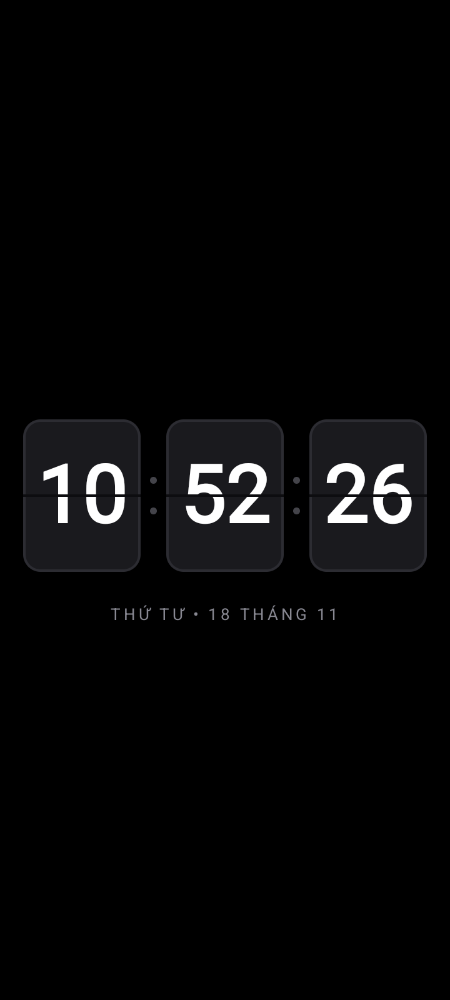

# 🚀 DroidX Launcher - Desk Clock & English Learning Station

**DroidX Launcher** là custom launcher Android được thiết kế và xây dựng độc lập 100% Native (Java + Android SDK, không phụ thuộc launcher bên thứ 3) nhằm tái sử dụng điện thoại cũ thành **trạm đồng hồ để bàn thông minh và trạm học tập tiếng Anh tập trung**.



---

## ✨ Tính năng nổi bật

1. 🕒 **Đồng hồ lật cơ học Retro 3D (Mechanical Flip Clock):**
   - Thiết kế chuẩn vintage với 3 cặp thẻ: **Giờ : Phút : Giây (`HH : MM : SS`)**.
   - Mỗi thẻ có đường cắt rãnh ngang (*horizontal split seam*) mô phỏng lá lật cơ học thực thụ.
   - Thẻ giây lật nhịp nhàng 90ms mỗi giây với hiệu ứng xoay 3D perspective.
   - Khử lệch thời gian (*jitter compensation*), đồng bộ chuẩn xác từng giây thực tế.
   - Giữ màn hình luôn sáng liên tục khi cắm sạc trên bàn làm việc.

2. 🔤 **Trạm học Tiếng Anh Flashcards (English Learning Station):**
   - Nhúng ứng dụng web học từ vựng [eng.dbivn.com](https://eng.dbivn.com/).
   - Tích hợp Native Bridge `AndroidTTS` (chuẩn giọng Mỹ `en-US` qua Google Text-to-Speech), polyfill `window.speechSynthesis` giúp phát âm chuẩn xác khi chạm vào thẻ học.
   - Tự động tối ưu hóa tài nguyên: tạm dừng (`onPause`) khi ở màn hình đồng hồ để không hao pin/CPU và tự kích hoạt (`onResume`) ngay khi vuốt sang.

3. 📱 **Kho ứng dụng sạch (Minimal App Drawer):**
   - Danh sách ứng dụng tối giản, tìm kiếm tức thì, lọc sạch bloatware hệ thống.
   - Nút lối tắt `⚙️` truy cập Cài đặt hệ thống nhanh chóng.

---

## 🔄 Cơ chế chuyển trang Rolling vòng tròn vô tận (Infinite Carousel)

Người dùng chỉ cần vuốt ngang màn hình trái/phải:
```
[ 🕒 Retro Flip Clock ]  ⇄  [ 🔤 Học Tiếng Anh ]  ⇄  [ 📱 Kho ứng dụng ]  ⇄  [ 🕒 Retro Flip Clock... ]
```
Vòng lặp khép kín, vuốt liên tục theo vòng tròn không bao giờ bị giới hạn điểm dừng.

---

## ⚡ Tối ưu hóa hiệu năng & Phần cứng (Hardware Acceleration)
- **GPU Layer Caching (`LAYER_TYPE_HARDWARE`)**: Tận dụng triệt để GPU để xoay texture quad 3D, giảm tải CPU hệ thống xuống mức tối thiểu (máy đạt >680% Idle).
- **Zero Animation Delay**: Cấu hình hệ thống triệt tiêu delay mở ứng dụng và chuyển cảnh.

---

## 🛠️ Cấu trúc thư mục mã nguồn
```
DroidX/
├── app/src/main/
│   ├── AndroidManifest.xml                  # Đăng ký quyền, HOME category, Hardware Acceleration
│   ├── java/com/droidx/launcher/
│   │   ├── MainActivity.java                # Logic 3 trang infinite rolling, Flip Clock 3D, Native TTS bridge
│   │   ├── AppInfo.java                     # Model dữ liệu ứng dụng
│   │   └── AppDrawerActivity.java           # Activity quản lý drawer
│   ├── res/
│   │   ├── anim/                            # Slide transitions (trái/phải)
│   │   ├── drawable/                        # Background thẻ lật, split seams, colon dots
│   │   ├── layout/                          # Giao diện chính (activity_main.xml)
│   │   └── values/                          # Màu sắc đen tuyền (bg_black, OLED friendly), strings
├── build.ps1                                # Pipeline build 1-click & nạp vào điện thoại trong 3 giây
├── DroidX_Launcher.apk                      # File APK thành phẩm sẵn sàng cài đặt
└── screenshots/                             # Hình ảnh chụp trực tiếp từ màn hình thiết bị
```

---

## 🔨 Cách build và cài đặt
Mở PowerShell tại thư mục dự án và chạy:
```powershell
.\build.ps1
```
Script sẽ tự động:
1. Biên dịch tài nguyên (`aapt2 compile/link`).
2. Biên dịch mã nguồn Java (`javac`).
3. Chuyển đổi mã bytecode sang DEX (`d8`).
4. Đóng gói APK, căn chỉnh bộ nhớ (`zipalign`) và ký số (`apksigner`).
5. Nạp trực tiếp vào điện thoại qua ADB và kích hoạt launcher.
